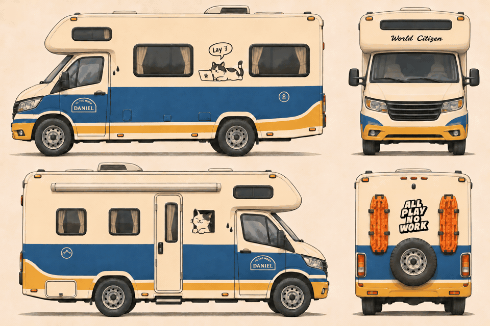

# 房车车衣交付 harness

项目特定的提示词、验收清单和交付物清单。通用、可重复的 Blender 步骤在 [`.claude/skills/blender-rv-wrap/SKILL.md`](../../../.claude/skills/blender-rv-wrap/SKILL.md)。本目录不写进技能，避免把这一款的色号和贴花变成通用步骤。

这不是 Harness.io，也不是网页功能。不跑 Blender，不改应用代码。

## 放在这里的原因

`docs/opc/` 已收车衣 / 拉花交付材料（方案包模板、素材库、合规说明），并且缺数不脑补。`docs/process/` 是协作流程，`docs/specs/` 是网页模型适配契约。本目录把这一次车衣交付收在一处，不散到那两个目录。

## 一次怎么交输入

同一次请求里一起上传，不要分次让执行者先用四视图把结构补上：

1. 成品四视图（涂装）。
2. 实拍（结构），尤其是双侧门窗。
3. 可选：原 `.blend`。有它就先另存副本，沿用已确认几何和比例，不重做整车。

缺实拍就不要猜造结构。没有实测尺寸就标「待量」，不要从透视照片硬推毫米。两侧不可默认镜像。

## 本轮输入状态（2026-11-26）

维护者要求先把流程沉淀进仓库。这一轮**没有**实拍，也**没有**原 `.blend`。

| 输入 | 本轮 | 执行时 |
| --- | --- | --- |
| 成品四视图 | 有。低分辨率副本见下方参考图 | 与实拍、可选原文件一起再交一次；有更清晰原图时以该次原图为准 |
| 实拍（双侧门窗） | 无 | 必须一起上传。没有就不要猜造尺寸或结构 |
| 原 `.blend` | 无 | 有则一起上传并先另存副本。没有则不要声称沿用了已确认几何，也不要补造毫米 |

执行者只拿到本目录、还没有实拍时：停在文档，不开始结构建模。

## 参考图

`four-view-paint-reference.png` 是本次提供的成品四视图的低分辨率副本（960×640，减色）。它是**涂装事实来源**，不是施工图，不能按它裁切或开料，也不提供毫米尺寸。

维护者对这张附件的说明：暖米黄／牛仔蓝／芥末黄，驾驶侧猫、副驾侧 TO THE MOON / DANIEL、额头 World Citizen、车尾 ALL PLAY NO WORK 与橙色脱困板。门窗开孔、色带走向和文字以 [prompt.md](prompt.md) 原文，加上执行时一起上传的四视图和实拍为准。图和原文对不上时标「待确认」。

## 文件

| 文件 | 用途 |
| --- | --- |
| [prompt.md](prompt.md) | 可直接粘贴给 Grok 3D / Blender 执行者的维护者原文 |
| [acceptance.md](acceptance.md) | 按原文逐条核对的验收清单 |
| [deliverables.md](deliverables.md) | 执行者交回的文件清单 |
| [four-view-paint-reference.png](four-view-paint-reference.png) | 低分辨率四视图，涂装事实来源 |

## 执行顺序

1. 读通用技能，确认输入门禁。
2. 核对上一节的输入状态。缺实拍或要猜尺寸时停止。
3. 把 [prompt.md](prompt.md) 围栏内原文整段交给执行者。
4. 交回的文件按 [deliverables.md](deliverables.md) 收，按 [acceptance.md](acceptance.md) 勾。
